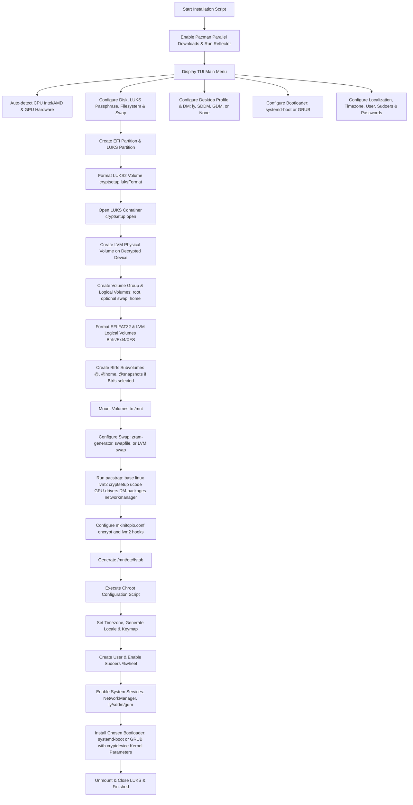

# Arch Linux Menu-Driven Interactive LUKS on LVM Installation Plan

## Overview
This document outlines the detailed design and implementation steps for a menu-driven Arch Linux installation script featuring LUKS2 full-disk encryption, Logical Volume Manager (LVM) support, configurable filesystems (Btrfs with subvolumes, Ext4, XFS), flexible Swap configurations (**zRAM**, **Swapfile**, **Dedicated LVM Swap Partition**, or **None**), CPU microcode auto-detection (**intel-ucode** / **amd-ucode**), GPU driver selection, **Display Manager choice (ly / SDDM / GDM / none)**, **Bootloader choice (systemd-boot vs GRUB)**, **Reflector mirror optimization**, **Pacman Parallel Downloads**, and complete system localization & user sudoers configuration.

## Workflow Architecture

## Proposed File Structure
- [`install.sh`](install.sh): Main entry point script presenting the TUI menu and orchestrating installation.
- [`chroot-setup.sh`](chroot-setup.sh): Configuration script executed within `arch-chroot`.

## Feature Breakdown
1. **Pacman Optimization & Mirror Ranking**:
   - Enable `ParallelDownloads = 5` in `/etc/pacman.conf`.
   - Run `reflector` to fetch top HTTPS mirrors sorted by speed: `reflector --latest 20 --protocol https --sort rate --save /etc/pacman.d/mirrorlist`.

2. **Menu Interface (TUI)**:
   - Target drive selection
   - LUKS Encryption passphrase prompt & toggle
   - Filesystem Selection: **Btrfs** (with automatic `@`, `@home`, `@snapshots` subvolumes), **Ext4**, or **XFS**
   - **Swap Configuration Options**: `zram`, `swapfile`, `lvm_swap`, or `none`.
   - **Hardware & Driver Detection/Selection**: CPU microcode (Intel/AMD auto-detected), GPU drivers (Nvidia/AMD/Intel/Generic).
   - **Desktop Environment & Display Manager**:
     - DE Profiles: Hyprland, KDE Plasma, GNOME, Minimal CLI.
     - Display Manager Choice: **`ly`**, **`SDDM`**, **`GDM`**, or **None**.
   - **Bootloader Choice**: **`systemd-boot`** or **`GRUB`**.
   - **System Localization & User Settings**:
     - Timezone selection (e.g., `Asia/Manila`, `UTC`, etc.)
     - Locale selection (e.g., `en_US.UTF-8`)
     - Hostname setup
     - User creation with automatic wheel group membership and sudoers privilege configuration (`/etc/sudoers.d/wheel`).

3. **LUKS2 + LVM Storage Setup**:
   - Create EFI partition (512MB).
   - Encrypt second partition with LUKS2 (`cryptsetup luksFormat --type luks2`).
   - Open LUKS volume (`cryptsetup open /dev/sdX2 cryptlvm`).
   - Create Physical Volume, Volume Group (`vg0`), and Logical Volumes (`root`, `home`, optional `swap`).

4. **Filesystem Creation & Mounting**:
   - Btrfs subvolumes (`@`, `@home`, `@snapshots`, `@var_log`) with mount options `compress=zstd,noatime`, or Ext4 / XFS mount.

5. **Initramfs Hooks, Bootloader & System Chroot Setup**:
   - Install packages via `pacstrap`.
   - Configure `/etc/mkinitcpio.conf` HOOKS line for `encrypt` and `lvm2`.
   - Set timezone symlink `/etc/localtime` and sync hardware clock (`hwclock --systohc`).
   - Generate locale (`locale-gen`).
   - Setup user account, set root and user passwords, enable `%wheel ALL=(ALL:ALL) ALL` in `/etc/sudoers.d/10-installer`.
   - Enable display manager service (`ly.service`, `sddm.service`, or `gdm.service`).
   - Install and configure chosen bootloader (**systemd-boot** or **GRUB**) with LUKS kernel parameters (`cryptdevice=UUID=<partition_uuid>:cryptlvm root=/dev/vg0/root`) and microcode `initrd`.
